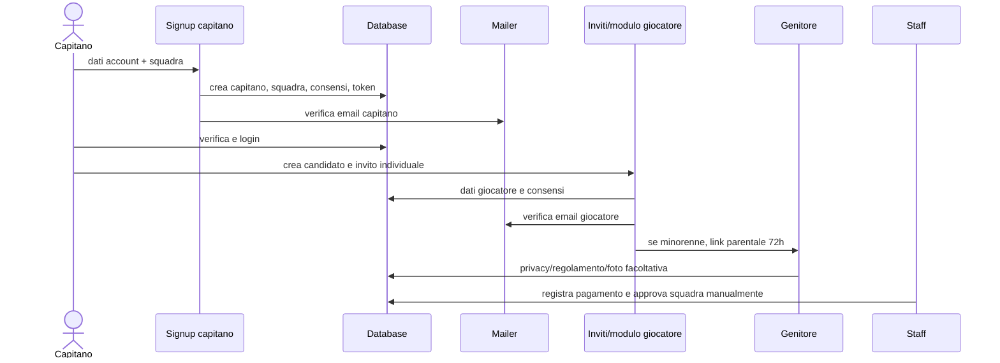

# 01 — Stato attuale del sistema di iscrizione

## Perimetro
Audit statico del branch `feature/iscrizioni`, HEAD `d25b49238f1335066d0428916e2a26953023e35d` (`gestione staff + allienamento css`). `git status --short --branch` pulito. Nessun accesso a database, produzione, email o partecipanti; nessun test eseguito e nessun codice applicativo modificato. I riferimenti descrivono il repository, non i dati runtime.

## Architettura e workflow reale

- PHP server-rendered, PDO/MySQL; `includes/db.php:12-31` usa prepared statements nativi. Env SMTP e configurazione in `includes/config.php:10-117`.
- Capitani distinti dagli account staff; signup in `capitano/registrati.php`, autenticazione/guard email in `includes/auth_capitano.php`.
- Signup crea account e squadra (sequenzialmente, senza transazione globale), ma non crea una persona nella rosa: `capitano/registrati.php:65-148`.
- Il capitano autenticato aggiunge un candidato (nome/cognome/email) e genera token individuale: `capitano/giocatori.php:82-125`; link copiabile: `:41-53`.
- Il giocatore completa i dati e consensi a `iscrizione/giocatore.php`; email verificata via link a `iscrizione/verifica-email.php`.
- Minore: classificazione usa data di inizio torneo (`includes/iscrizione_helper.php:15-29`); raccoglie nome/cognome/email genitore e manda link 72h dopo verifica giocatore (`iscrizione/verifica-email.php:34-47`). Nessun OTP.
- `avanza_stato_giocatore()` determina il completamento usando verifica email e campi limitati, consensi genitore privacy/regolamento per minori (`includes/iscrizione_helper.php:79-156`).
- Squadra `completa` se tutti i giocatori non annullati hanno stato completo, senza minimo/massimo, pagamento o approvazione (`includes/iscrizione_helper.php:58-77`). Pagamenti distinti e manuali (`admin/pagamenti/inserisci.php:9-63`).
- Staff: ruoli/capability espliciti in `includes/staff_authorization.php:7-48`, guard in `includes/auth.php:28-55`; panoramica iscrizioni in `admin/iscrizioni/index.php:8-12`.
- Schemi: `assets/sql/database_schema_torneo.sql` e `database/schema_complete.sql`; il secondo è dichiarato per DB vuoto, non migrazione (`database/schema_complete.sql:1-12`).

## Implementato / parziale / mancante

**Implementato:** account capitano password-hash + verifica email; autorizzazione accesso capitano; inviti individuali; verifica email giocatore; consenso genitoriale basilare; documenti versionati e record consensi positivi; pagamento manuale; ruoli staff espliciti; CSRF nelle operazioni capitano/staff esaminate.

**Parziale o difettoso:** `MAX_SQUADRE` solo env/default 20 e conteggio non atomico; max rosa in conflitto (9 o 10); nessun minimo; età minorenne valutata alla data torneo; foto memorizzata solo se concessa e nessun rifiuto/revoca; approvazione esiste come `autorizzata` ma non guida completamento; token genitore senza OTP; pagina iscrizioni è sola lettura.

**Mancante:** capitano nel roster con consensi; CF giocatore/genitore; età minima 16 alla submission; dati completi e dichiarazione genitore; email parentale distinta/verificata; OTP; responsabilità separata; carta/PDF/QR e tracciamento; sostituzioni storiche; termine configurabile; unicità per persona/edizione e cross-team; controllo team minimo 8 e quota+approvazione congiunti; conferma e riepilogo email; revoche append-only; retention. Non individuati test registration-specific.

## Rischi regressione e deploy
`giocatori` è referenziata da rose/eventi/classifiche: non cancellare fisicamente righe storiche senza piano. Trigger differenti 9 vs 10 e default quota differenti rendono deployment dipendente dallo schema importato. Validare AlterVista effettivo (versione MySQL/MariaDB, trigger, vincoli, transazioni e supporto migrazioni); nessun test hosting effettuato.
