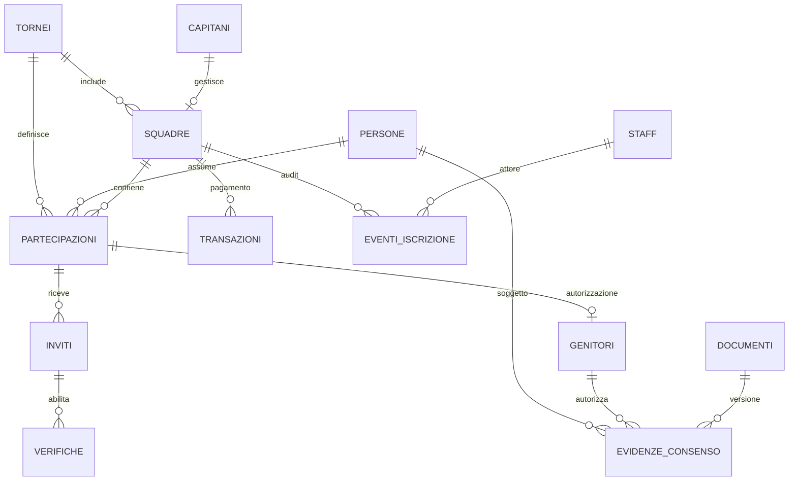

# 03 — Analisi database

## Schema esistente

Riferimento principale legacy `assets/sql/database_schema_torneo.sql`; installazione unificata più recente `database/schema_complete.sql`. La seconda si dichiara schema per DB vuoto, non migrazione (`database/schema_complete.sql:1-12`). Il codice fa verifiche dinamiche `table_has_column()` (`includes/db.php:53-67`), indizio che installazioni possano divergere.

| Tabella | Relazioni/usi | Limiti rispetto ai requisiti |
|---|---|---|
| `tornei` | Edizione, stagione, date, attivo; `squadre.id_torneo` FK nullable. | Nessun max squadre/deadline/config registrazione; data torneo viene impropriamente usata per età. |
| `capitani` | Account, password hash, anagrafica, email unica, verifica timestamp. | No CF; nessun mapping del capitano alla persona/membership di rosa. |
| `squadre` | FK capitano unica e torneo; quota, `stato_iscrizione`, `stato_pagamento`, `attiva`, `autorizzata`. | Stato team non codifica approvazione composta; schema può consentire capo nullo; configurazione globale max esterna. |
| `giocatori` | FK squadra; anagrafica e stato; FK eventi. | Nessun CF/email verificata timestamp/membership storica/edizione diretta; no univocità persona per torneo; email non univoca. Trigger diversi: legacy max 9 (`assets/sql/database_schema_torneo.sql:134-158`), recente max 10 (`database/schema_complete.sql:271-295`). |
| `genitori` | 1:1 giocatore, nome/cognome/email, telefono nullable (`assets/sql/database_schema_torneo.sql:246-259`). | No CF, indirizzo, status/dichiarazione parentale o verifica email; collation attuale case-insensitive ma normalizzazione applicativa da specificare. |
| `tipi_documento`, `documenti` | Versione documento per tipo. | URL/versione senza hash contenuto o immutabilità tecnica; documenti provvisori. |
| `consensi` | FK documento e uno fra capitano/giocatore/genitore, esito boolean, timestamp/IP/UA (`:298-321`). | Nessun CHECK exactly-one subject, tipo evento/canale/diniego esplicito/revoca/storico e vincolo idempotenza. ON DELETE CASCADE cancella prove con persona. |
| `token_verifica` | Tipo/email/reset/invito/genitore, hash token, scadenza/usato/invalidato e FK soggetti (`:323-346`). | Nessun OTP, tentativi/lock/rate state, scope edizione; hash già positivo; tipo ENUM richiede migrazione. |
| `transazioni` | Pagamenti manuali squadra/metodo/operatore (`:360-378`). | Nessun gateway, coerente col requisito; indice per squadra da valutare. Stato separato. |
| `impostazioni` | Coppia chiave/valore globale. | Adatta a quota default ma non setting per edizione e non deadline/max team (schema oggi solo quota). |

## Compatibilità e rischi

`assets/sql/database_schema_completo.sql` è ulteriore variante SQL da confrontare prima di ogni intervento. In `database/schema_complete.sql` quota default 200 (`:235,525-527`), in schema storico 180 (`assets/sql/database_schema_torneo.sql:98,388-390`). Trigger e ENUM differiscono. `CREATE TABLE IF NOT EXISTS` non aggiorna installazioni esistenti. Non eseguire uno schema di bootstrap su DB esistente. Le procedure migration vanno provate su copie anonime/sintetiche e staging. Trigger, `SIGNAL`, `FOR UPDATE`, CHECK, charset/collation e DDL transaction support dipendono da versione MySQL/MariaDB/hosting AlterVista; la versione reale è sconosciuta.

## Schema futuro proposto (logico)

Evolvere senza riscrivere subito le entità torneo: `tornei` diventa fonte per `max_squadre`, `scadenza_iscrizioni`, `min_giocatori`, `max_giocatori` e parametri; tabella `persone` (anagrafica canonica con CF normalizzato, email/telefono/indirizzo e data nascita) referenziata da account capitano e ruoli; `partecipazioni` (persona, torneo, squadra, stato corrente, ruolo capitano, invito/registrazione), con un solo team attivo per persona/torneo; mantenere o migrare `giocatori` come compatibilità storica/eventi.

`inviti` separati dai bearer token con creatore, destinatario, team/edizione, expiry, stato; `verifiche` per email/OTP con hash, scadenza, contatore tentativi, consumato, lock e canale; `genitori` associati a partecipazione minorenne, dati richiesti e relazione dichiarata; `documenti` versioni immutabili (hash); `evidenze_consenso` append-only con soggetto, controllo, doc versione, esito, timestamp, IP/UA, canale, parent link/OTP result; `eventi_iscrizione` per sostituzioni, approvazioni, pagamenti confermati, revoche e carta. Non salvare copie ID.

## Vincoli, indici e migrazione proposti

1. Duplicare/bonificare i dati esistenti: normalizzazione CF mai inventata; segnalare collisioni per verifica manuale. Definire gestione legacy con CF mancante, non bloccare update di dati storici senza policy.
2. Unique `partecipazioni(persona_id, torneo_id)` per partecipazione attiva (MariaDB/MySQL partial-index limitation: usare tabella membership corrente o generated active key); unique hash token; indici `(torneo_id, squadra_id, stato)`, token per `(tipo, soggetto_id, scadenza)`, consensi `(soggetto,tipo,created_at)`, pagamenti per squadra/stato.
3. FK coerenti InnoDB e tipi identici; CHECK/trigger solo dopo compatibilità hosting. Evitare unique email quale identità; confronto email lowercase/trimming per conflitto indirizzi, senza dedurre persona dagli alias.
4. Migrazione in fasi expand-migrate-contract, backup testato, preflight collisioni, rollback per step, compatibilità codice vecchio/nuovo. Conservare dati/evidenze tramite `ON DELETE RESTRICT` o tombstone per persone e audit. Non applicare ora.
5. Rimuovere trigger max divergenti soltanto nella migrazione approvata; tetto 10 applicato con lock riga squadra, non semplice COUNT concorrente. Team cap e deadline anch’essi protetti in transazione/serializzazione.

## Modifiche strutturali necessarie
Attributi configurabili per torneo; identità/persona e roster membership con storia; CF normalizzato e indice di unicità edizione; genitore completo; stato email e OTP; consensi append-only e documenti con version hash; audit approvazione/sostituzione/cartaceo; policy retention parametrica e scadenze. Le precise colonne e conversioni dipendono da decisioni aperte, non vanno codificate prima della verifica del DB reale.
